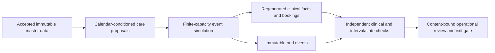

# Capacity-integrated synthetic patient flow

This package implements Phase 4 of the synthetic data plan. It extends the accepted clinical foundation with calendar-conditioned demand, finite bed capacity, actual placement, ICU stepdown, continuous site transfers, cleaning, closures, reservations and corrected source history. The accepted master and clinical snapshots remain unchanged.

The release still has 25 business tables and 1,958,210 planned records. This interim candidate populates 16 tables; workforce, inventory, charges, claims and finance follow in later phases. The [acceptance gate](../../evidence/operational-flow/acceptance-gate.json) is the authority for completion. Final data acceptance and analytics solution development remain blocked.

Read the [generation design](generation-design.md), [runbook](runbook.md), and [validation and review](validation-and-review.md). The implementation creates local synthetic data only. It does not deploy Databricks, forecasting, dashboards or agents.

All four operational exit criteria pass with 197 regression tests, fifteen clinical groups, seven operational groups and a recorded 100-case plausibility review. The accepted operational candidate has 938,452 canonical records, 71,018 bed events and no unexplained reconciliation differences. See the [control totals and verification scope](validation-and-review.md). Phase 5 has not started.
