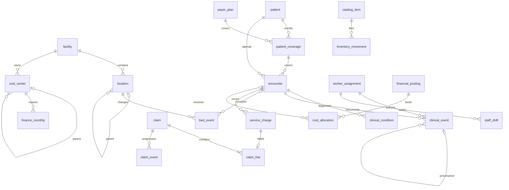

# Relationships, version identities and fact grains

The complete physical reference map is in `schema.json`, the generated dictionary, and the offline SQL contract. Every declared physical FK targets a matching typed primary key. Key metadata does not replace explicit data validation in later phases.

## Explicit business cardinalities

| Relationship | Cardinality and condition |
| --- | --- |
| Stable patient to patient versions | 1:M; only one applicable bitemporal rectangle per as-of identity assertion |
| Stable worker to assignment versions | 1:M; one exclusive primary assignment at an instant in baseline |
| Patient to coverage | 1:M over time; one primary enrollment at an instant; SELF_PAY explicitly modeled |
| Episode to encounters | 1:M same stable patient; ED-to-IPD is two encounters; internal bed transfers are not new encounters |
| Stable encounter to encounter versions | 1:M; arrival, admission and completion facts are later knowledge versions |
| IPD encounter to bed intervals | 1:M, derived from bed events; never overlapping for a patient |
| Bed to occupants | At most one at an instant; reservations are not occupants |
| Encounter to diagnosis/problem/allergy | 0:M; completed assessed encounters require a primary diagnosis or explicit reviewed diagnostic uncertainty |
| Order to result/admin/procedure | 1:M compatible typed children; same patient/episode and earlier active order |
| Charge to original claim line | 1:0..1; some charges are unbilled/self-pay/open at cutoff |
| Original claim to lines/events | 1:M; corrected attempts do not become new original claim IDs |
| Expense monthly pool posting to allocations | 1:M within selected allocation run; pool can include patient/nonpatient/residual destinations |
| Financial account actual to ledger | Aggregation at month/center/account/currency; not a row-level FK to one posting |
| Medication administration to inventory | Many-to-one consumption group/lot/unit/day; matching converted base-unit totals, not one arbitrary inventory row per dose |

## As-of join recipe

1. Fix business observation time `v` and knowledge cutoff `k` independently.
2. For bitemporal records require `valid_from <= v < valid_to` and `known_from <= k < known_to`, treating null ends as infinity.
3. Require `recorded_at <= k` and `export_available_at <= k`. For streamed sources, delivery time must also be within the observed consumer's cutoff.
4. Resolve one revision per stable identity before joining related facts. Encounter/clinical/shift lifecycle revisions use knowledge intervals; event occurrence is not permission to see a later revision early.
5. Use immutable referenced snapshots for original provenance. If current/as-of state is required, resolve through the stable entity identity with the same version-selection policy.
6. Aggregate independent facts before joining: diagnosis rows, clinical events, bed intervals, charges and allocations each have separate grains. A direct join of all children is prohibited for additive measures.
7. Natural keys containing nullable account IDs, such as statistical finance rows, are compared null-safely in duplicate checks. SQL NULL behavior must not permit duplicate statistical facts.

## Typed logical references

`worker_assignment.manager_worker_id` and `access_scope.worker_id` resolve through stable workers, with business/knowledge validity. `access_scope.scope_key` resolves according to scope type; only NETWORK uses `ALL_NETWORK`.

`source_key_map` targets stable patient/worker IDs, immutable location/cost-center/catalog/payer IDs, or explicit unit-to-cost-center association mappings. A UNIT_COST_CENTER mapping's source key encodes the canonical unit; the target is a cost center. It does not rewrite prior event-level attribution.

`financial_posting.source_group_key` links the exact contributing source predicate by domain. Workforce uses completed eligible shift versions; inventory uses signed movements; revenue uses eligible service charges and explicit recognition adjustments; AR/cash uses claim events; monthly pool-close uses mapped expense-posting groups. Every group must be independently recomputable.

## Clinical event family contract

Every row is one scalar fact or document, never an uncounted panel of analytes. `clinical-type-matrix.json` defines the required fields and catalog domains. Status determines whether an administration consumes stock or a procedure is billable. An unperformed event has no consumed stock or earned charge. A document carries text and document type, not a fictitious clinical catalog code.

An observation may be POINT or explicitly labeled DAILY_MIN/MAX/MEAN with a real period. A summarized value must not be presented as a raw point measurement or full telemetry. The baseline has selected variables with defined capture semantics, not unrecorded high-frequency readings hidden in one row.
