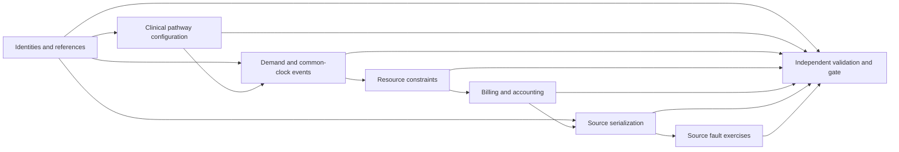

# Phase 1 architecture and control contracts

## Module boundaries

The eight registered modules are technical stages within Phase 1, not additional implementation phases. Each receives a copied configuration, versioned miniature references, and only its declared parent artifacts. It returns exactly `tables` and `controls`; a business projection has one owner. The module registry and topological dependency graph are explicit. No configuration can execute arbitrary Python or replace the approved graph.

| Stage | Development implementation | Later expansion |
| --- | --- | --- |
| identities | Three named people including a legitimate full-name collision, two knowledge versions of one named worker, two test code releases | Phase 2 population, organizations, coverage, crosswalks and official references |
| clinical | Validates the configured observation bounds and resolves the effective, released code version | Phase 3 reviewed longitudinal pathways, diagnoses, orders and clinical constraints |
| demand | Separate linked ED/IPD visits, seeded acuity and scalar observations scheduled on a UTC clock | Phase 3 variable arrivals, censoring, repeat visits and conditional demand |
| resources | Two bed intervals with a simultaneous transfer boundary, DST shift, signed stock ledger | Phase 4 full capacity, workforce and inventory simulation with feedback |
| billing | Exact charges, original claim, partial payment, linked refund, cash/AR journals, conservative cost allocation and monthly actual | Phases 5–6 complete recognition, claims, cost pools and planning vintages |
| serialization | Explicit Workday worker and Axiom finance CSV projections with manifests | Phase 7 tenant-style layouts and the full source contract catalog |
| faults | Real duplicate, late, missing, schema, mapping, replacement and corrupt-delivery exercises | Phase 7 broader contract recovery and challenge release |
| validation | 55 rule-family positives, 123 intended-detector negatives, independent candidate/export checks, profiles and reconciliation | Phases 2–9 complete data rules and final acceptance |

Clinical, operational and accounting fixture values are in configuration/reference/fixture contracts. Algorithms and interface field names are code. Fixed adversarial examples and literal golden expectations are test inputs, intentionally independent from generation formulas. The source adapters are simulators; no live Workday, Axiom, Azure or hospital system is accessed.

## Deterministic execution

IDs use SHA-256 over a namespace and typed source/business keys, truncated to 128 bits with a readable namespace. Names are never identity keys. Seed changes preserve identity links. Duplicate/collision checks still apply; a hash is not permission to merge distinct source keys.

Random draws use HMAC-SHA-256 keyed by seed, with entity, named stream, counter and rejection attempt as input. Rejection sampling avoids modulo bias. There is no shared RNG state or Python `hash()` dependency. Adding or reordering people does not move another person's stream.

Canonical JSON normalizes Unicode to NFC, sorts object keys and whole scalar rows, retains duplicate rows, uses exact decimal strings, and rejects binary floats, naive timestamps, nonfinite numbers and normalized-key collisions. Effective/known/available times are business content and stay in hashes. Only separate execution metadata such as start/finish timestamps and checkpoint attempts is volatile. No business field is dropped by a broad “ignore metadata” rule.

The runtime lock pins CPython 3.10.10, tzdata 2025.2 and the exact packaged `America/Chicago` zone bytes. `ZoneInfo.from_file` prevents the host database from overriding those bytes. A mismatch fails before generation. Python documents both the Windows tzdata dependency and ambiguous-time `fold` behavior in its [zoneinfo documentation](https://docs.python.org/3.10/library/zoneinfo.html).

The common clock is monotonic UTC. Events sort by instant, priority and stable event ID; a handler can schedule later feedback events. Duplicate IDs, past events and events beyond the configured boundary are rejected. DST spring gaps are invalid; a repeated fall hour requires explicit `fold`. Elapsed shift time uses UTC seconds. Age follows the frozen Phase 0 Feb-28 convention for Feb-29 birthdays in nonleap years. Business and knowledge intervals are half-open; code lookup also checks release availability. The scheduler is reusable; the full capacity-feedback simulation is Phase 4 work.

Generation runs and independent validation each establish their own 38-digit decimal context with `ROUND_HALF_UP`, preventing ambient process rounding settings from changing results. Allocations round the total to cents, distribute by largest remainder and break equal remainders by key. Signed reversals preserve exact conservation. No “balancing” row is invented to hide a discrepancy. Independent chronology also checks the local 2023–2025 care boundary; the delivery grace interval cannot create post-cutoff care.

## Publication, restart and invalidation

Each run directory has an operating-system single-writer file lock. Windows byte-range locking and Unix `flock` release automatically on process death. SQLite WAL with `synchronous=FULL` stores stage payload, input fingerprint, checksum and row count in one transaction. An exception or real process exit before commit publishes neither the stage nor its checkpoint. Earlier committed stages remain reusable.

Fingerprints include code bytes, all Phase 0/1 JSON contracts, runtime lock, reference bytes, seed, clock, cap, local stage configuration and parent artifact checksums. Stage configuration changes invalidate that stage and its transitive descendants; unaffected ancestors remain. Validation expectation changes rerun validation only. Code, reference, seed, runtime or contract changes conservatively invalidate all stages. This favors correctness over minimum recomputation.

Invalidation commits before recomputation. A failed changed upstream stage therefore cannot leave old downstream checkpoints eligible. The runner immediately marks the manifest `RUNNING` and removes the two previous derived fixture export files; a failure cannot leave a previous passing export looking current. A crash leaves `RUNNING` evidence, and the next run marks its attempt `INTERRUPTED`.

Every cached payload checksum is verified before reuse. Corruption fails closed and preserves the checkpoint store for investigation; the runbook uses a new output directory for a clean rebuild. Successful payloads are materialized atomically with `os.replace`. The independent inspector verifies current input locks, every stage checksum, the table artifact checksum/count, the framework gate and that the manifest did not change during inspection.

## Counting and gate behavior

The approved CLI accepts `DEVELOPMENT_FIXTURE` only, with a configurable cap of 1–500 rows (default 100). Every scalar version/child row in owned projections counts before stage commit. A stage cannot exceed the frozen per-table envelope, add an unregistered table, use nested business facts or share projection ownership. The full release ceiling remains 2,000,000; the development profile cannot enable a full run.

The manifest separately reports 30 development rows, 15 fixture projections, the frozen 25-table release boundary, 3 serialized mirror rows and their byte count. Hand-authored test inputs, microfixture expected values and fault results are test/control artifacts, not an uncounted extension of a healthcare release. They are never loaded as canonical healthcare tables.

P0 and P1 findings automatically block the fixture gate. Unknown checks, missing required data, detector errors, empty evidence and unknown statuses/severities cannot pass. An expected negative control must actually fail its intended detector; removing a detector causes the negative-control gate to fail. The expected fault finding stays in the negative-control result, while unresolved defects describe unexpected candidate failures.

Defect IDs derive from rule and affected key; reasons are recorded. SQLite retains defect discovery payloads and current `OPEN`/`RESOLVED` status, plus all run-attempt manifests. After an upstream fix passes, prior defects become resolved. Both the fixture and independent gates always carry `dataset_accepted=false` and `BLOCKED_FOR_SOLUTION`.
