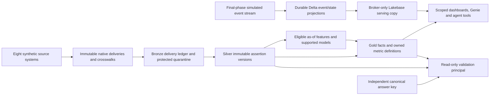

# Healthcare platform architecture baseline

Phase 0 establishes the design, validation and cost contracts. It does not implement or certify the future analytics platform. The [gate](../../evidence/platform/architecture-baseline/gate.json) is the completion authority; later gates remain unpassed.

The user explicitly approved the reduced synthetic POC workload at **INR20,000**, preserving the **INR6,000** monthly target. The modeled build is **INR17,802.05**, including prerequisite uncertainty and contingency. Four estimated Genie DBUs per question instead of two reaches **INR19,850.53**; a simultaneous 10% increase in rates and FX fails at **INR21,183.59**. These are priced estimates, not measured workload costs. Every funded execution requires measured pilot/remaining-work admission.

| Exit criterion | Baseline artifacts and evidence |
| --- | --- |
| 0.1 — fifteen approved decisions | [ADR register and RACI](../contracts/architecture/design-review.json), [workspace topology](adr/workspace-topology.md) through [gate/migration contract](adr/gates-workloads-migrations.md) |
| 0.2 — dated capabilities, quotas, versions and probes | [19-capability matrix](../contracts/architecture/capability-matrix.json), [16-probe plan](../contracts/architecture/probe-matrix.json), [compatibility manifest](../contracts/architecture/compatibility-manifest.json), [official price evidence](../../evidence/platform/architecture-baseline/price-evidence.json) |
| 0.3 — priced build and operating profiles | [Cost model](../contracts/architecture/cost-model.json), [approved scope/cost review](build-budget-review.md), [spending boundaries](../contracts/architecture/spend-controls.json), [training threshold](adr/training-location-cost.md) |
| 0.4 — frozen source, business and test dependencies | [25-table/526-column source matrix](../contracts/architecture/source-contracts.json), [temporal contract](../contracts/architecture/delivery-temporal.json), [42 KPIs](../contracts/architecture/kpi-catalog.json), [55 DQ rules](../contracts/architecture/data-quality-contracts.json), [13 ML dispositions](../contracts/architecture/ml-eligibility.json), [workloads](../contracts/architecture/test-workloads.json), [fourteen-phase gates](../contracts/architecture/gate-dependencies.json) |

The existing Premium SERVERLESS East US workspace is adopted, never recreated. Supporting infrastructure stays in dedicated resource groups. `hc_dev`, `hc_test` and synthetic `hc_prod` are logical environments; `hc_ops` contains operational/security state. Terraform, Bundles and API adapters have exclusive resource owners in the [lifecycle/security register](../contracts/architecture/security-ownership.json). The external control plane owns sleep/wake state in ADLS and checks idle resources without starting a Databricks workload.

The exact Luna route remains Databricks Unity Gateway → UC managed-identity credential → Azure OpenAI `gpt-6-luna`, revision `2026-09-22`, US Data Zone Standard in the second MCPP subscription. The tested capacity is only **5 RPM /5,000 TPM**. Required Phase 2 rate/token sizing must establish capacity for the declared ten-user workload with headroom. A quota shortfall blocks dependent work; no model or processing-geography substitution is implicit. Native ADI remains unavailable in the account.

The accepted release is `healthcare-synthetic-v1.1.0`, descriptor `c36a9b7841743057be2f6993a27790c82a170c847399687a0c2647b5b9167af5`. It contains **25 tables, 1,937,925 business rows**, 3,445 native deliveries, 7,126 payload files and approximately 4.47 GB. Three fictional Illinois hospitals and 72 beds cover 2023–2025 with America/Chicago business dates. Opening assertions and boundary exports are retained. Nested historical producer flags do not override current acceptance. Phase 0 changes no source record.

Delivery identity includes release, source, feed and manifest identity. SHA256 checks integrity; it does not identify a delivery. Distinct empty/equal-hash extracts remain observable, and replay of the same immutable delivery adds no business payload. Source assertion keys preserve all revisions. Business-valid, source-known, export-available, actually-ingested and serving-ready times are independently auditable. The source matrix derives physical dependencies from every column reference, distinguishes self/history and polymorphic associations, and puts locations before dependent worker assignments and encounters.

Financial outputs conserve cents at their real grains. Patient allocations and explicit nonpatient destinations reconcile together to eligible expense pools for the selected allocation run. Finance scenarios, vintages, currency and statistical units are never aggregated together. Encounter/month/category contribution is an estimate; procedure profitability and complete enterprise profitability are outside this dataset.

The agent runs inside its costed FastAPI App; only the two M4/M10 risk products have standalone Model Serving endpoints. Document embeddings are prepared locally, query embeddings run in app CPU and share the pinned model/dimension. App memory/latency must pass the later gate before publication.

The ML register does not promise thirteen learned models. M6 is a derived source-rule-derived product; M11 is retrospective-only; sparse products may remain baselines or insufficient-data. M4 predicts conditional remaining LOS at the first eligible visible active stay, M5 uses an hourly ceiling after availability, M10 predicts first adjudication only from a visible pending original claim, and M12 starts when an eligible discharge is visible. Unavailable elective schedules/readiness and future realized covariates are excluded. Training/selection/holdout windows match the roadmap, with outcome maturity, censoring, support and calibration gates frozen before model selection.

Security uses trusted Entra object IDs and an approved facility/persona bridge. Synthetic Workday entitlement rows cannot grant cloud access. OBO SQL/Genie, per-app identities, protected raw/quarantine, brokered search, copied-state predicates, session ownership and revocation are tested independently. Internally synced Lakebase tables cannot carry Postgres RLS: only the trusted broker reads them and applies verified scope predicates; app-owned session/budget tables use transactional/RLS controls. The runtime cannot read the canonical oracle, and the independent validation principal cannot write business tables.

The approved POC has 20 initial native Genie questions per space, then two targeted cases per space at recreation/batch/RTI release, with all deterministic SQL, security and reconciliation checks retained. The scope review describes the narrower stochastic coverage. Full200-case agent evaluation still runs in Phases10,12,13; performance samples remain at least100 completed requests per deployed component and ten users. Five Gold replay days, a separate largest-delivery/DST-gap case, seven Autopilot replay days and all mandatory fault/recovery checks remain.

RTI is last. Continuous micro-batch Delta processing, durable seed/outbox/archive, permanent event identity, independent reducers, late repair and new source-instance checkpoints are required. Warm p95 targets are <15s raw Delta, <30s reconciled state, <60s serving copy and <75s screen. Five long-horizon offline seeds assess realism separately from the two-hour live plus30-minute accelerated soak. Historical simulation time never substitutes for wall-clock latency.

Phase 2 must execute and clean up the required tenant probes before onboarding; P11 inbound webhook alone may be unsupported if safely disabled and authenticated polling passes. Search/Lakebase/Apps/serving availability, billing quantities, Luna concurrent capacity and outbound notification destinations remain explicit later hold points. A Phase 0 PASS certifies this design/probe plan, not those future outcomes. The [validation runbook](runbooks/validate-architecture.md) explains reproduction, approval binding and controlled revisions.
